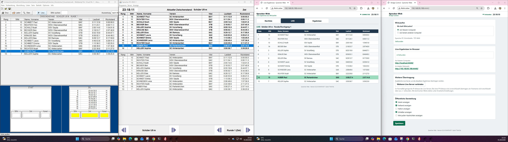

# Sprecher-Web

[](pom.xml)
[](LICENSE)

**Live-Ergebnisse aus WinLaufen auf Notebook, Tablet und Smartphone.**
Sprecher-Web macht die Ergebnisse Ihrer Zeitnahme im Browser zugänglich:
Sprecher, Trainer und Zuschauer können im Veranstaltungsnetz mitlesen,
ohne eine zusätzliche App zu installieren. WinLaufen bleibt Ihre
Wettkampfsoftware; Sprecher-Web liest die bereitgestellten Daten mit.
Repository und Linux-Kommando heißen nach dieser Zeitnahmesoftware
`winlaufen-web`.

**Status:** Im Praxistest – bei einem realen Wettkampf in Oederan am
13.09.2026 im End-to-End-Betrieb mit Uhr- und Ergebnisdaten erprobt
([Projektstatus](docs/STATUS.md)).

`WinLaufen → Sprecher-Web → Browser`



## Was kann Sprecher-Web?

**Für Sprecher:** laufende Wettkampfzeit, aktuelle Zieleinläufe und
Ergebnistabellen auf dem eigenen Notebook oder Tablet, unabhängig vom
Zeitnahme-PC.

**Für Trainer und Zuschauer:** Ergebnisse und Startlisten nach Klassen im
Browser des Smartphones, ohne App; erprobt für Lauf und Biathlon.

**Für Veranstalter:**

- **Startlisten bereitstellen:** Export aus WinLaufen als CSV, TXT oder XLSX
  importieren.
- **Die Anzeige anpassen:** etwa, ob Verein, Verband, Nation, Schießen und
  WinLaufen-Nachrichten angezeigt werden.
- **Verbindungsprobleme erkennen:** Die Anzeige kennzeichnet veraltete Daten
  und verbindet nach einer Unterbrechung automatisch neu.
- **Im lokalen Netz arbeiten:** Für den Betrieb vor Ort ist kein Internet nötig.
  Weitere Live-Server können die Ergebnisse zusätzlich im Internet
  bereitstellen.

## Welche Variante brauche ich?

### Empfehlung: All-in-One auf einem separaten Rechner

Wir empfehlen, **Sprecher-Web auf einem eigenen Rechner im selben Netzwerk wie WinLaufen zu installieren**. Besonders geeignet ist ein Linux-PC mit Debian oder Ubuntu. Alternativ kann auch ein Windows-Rechner verwendet werden.

>WinLaufen läuft auf dem Windows-Zeitnahme-PC.
>Sprecher-Web empfängt die Daten über das Netzwerk und stellt sie im Browser bereit.

**Ein Windows-Sprecher-PC ist damit nicht mehr unbedingt erforderlich.** Der Sprecher kann auch direkt an einem Linux-PC arbeiten oder die Ergebnisse auf einem beliebigen Notebook, Tablet oder Smartphone im lokalen Netzwerk über einen Browser aufrufen.

`WinLaufen-PC → Linux-PC mit All-in-One → Browser im lokalen Netzwerk`

**Vorteile dieser Variante:**
- Der Zeitnahme-PC bleibt von zusätzlicher Software unberührt.
- Der Sprecher kann unabhängig vom Zeitnahme-PC arbeiten.
- Mehrere Geräte können gleichzeitig auf die Live-Ergebnisse zugreifen.
- Für den lokalen Betrieb ist keine Internetverbindung erforderlich.
- Die Ergebnisse können zusätzlich an einen Live-Server im Internet weitergeleitet werden.

### Zum Ausprobieren: All-in-One direkt auf dem WinLaufen-PC

Wer Sprecher-Web zunächst nur testen möchte oder keinen zweiten Rechner zur Verfügung hat, kann All-in-One auch direkt auf dem Windows-PC mit WinLaufen installieren.

`WinLaufen + Sprecher-Web auf einem Windows-PC → Browser`

Diese Variante funktioniert ebenfalls, ist aber für den regelmäßigen Wettkampfbetrieb nicht unsere bevorzugte Lösung.

### Optional: Live-Ergebnisse über das Internet

Eine All-in-One-Installation im lokalen Netzwerk kann die Ergebnisse **gleichzeitig vor Ort bereitstellen und an einen zusätzlichen Live-Server in der Cloud weiterleiten**.

Dazu wird auf dem Cloud-Server das Profil **Presentation Node** installiert. Die lokale All-in-One-Installation bleibt unverändert und übernimmt weiterhin die Verbindung zu WinLaufen.

`WinLaufen-PC → All-in-One im LAN → Cloud-Server → Internet-Browser`

Für spezielle Installationen kann statt All-in-One auch das Profil **Bridge only** verwendet werden. Dieses empfängt die WinLaufen-Daten und leitet sie weiter, ohne selbst die Browseranzeige bereitzustellen.

Weitere Informationen stehen in der [Anleitung für temporäre Cloud-Server](docs/QUICKSTART_CLOUD.md).

**Hinweis:** Die aktuelle Version ist für kontrollierte Veranstaltungsnetze ausgelegt. Ein öffentlich erreichbarer Cloud-Server sollte nur unter Beachtung der dokumentierten Sicherheits- und Einsatzgrenzen betrieben werden. 
Ein dauerhaft öffentlich betriebener Dienst sollte zusätzliche Sicherheiten bekommen.

## Schnellinstallation

Laden Sie auf der [Releases-Seite](https://github.com/richtertoralf/winlaufen-web/releases)
unter **Assets** das fertige Paket für Ihren Rechner herunter.
Die benötigte Java-Umgebung ist enthalten. Wählen Sie die unten genannte
Paketdatei; die Anhänge **Source code** sind nicht zur Installation gedacht.

Falls die Sprecher-PC-Verbindung in WinLaufen bereits aktiv ist, wählen Sie
vor der Installation **Abwicklung → Sprecher-PC… → Trennen**.
WinLaufen selbst kann geöffnet bleiben.

### Windows 11

1. Laden Sie `winlaufen-web-<version>-windows-x64.zip` herunter.
   `<version>` steht für die Versionsnummer des ausgewählten Pakets.
2. Öffnen Sie im Browser die Downloadliste mit **Strg+J** und wählen Sie bei
   der ZIP-Datei **In Ordner anzeigen** (je nach Browser ein Ordnersymbol).
3. Klicken Sie im Explorer mit der rechten Maustaste auf die ZIP-Datei und
   wählen Sie **Alle extrahieren… → Extrahieren**. Öffnen Sie den entpackten
   Ordner und gegebenenfalls den darin liegenden gleichnamigen Unterordner,
   bis Sie **installer**, **lib** und **runtime** sehen.
4. Klicken Sie in die Adressleiste des Explorers und kopieren Sie den
   vollständigen Ordnerpfad mit **Strg+C**.
5. Suchen Sie im Startmenü nach **Windows PowerShell**, wählen Sie
   **Als Administrator ausführen** und bestätigen Sie die Windows-Abfrage.
6. Führen Sie die folgenden Zeilen einzeln aus. Ersetzen Sie in der ersten
   Zeile `HIER DEN KOPIERTEN ORDNERPFAD EINFÜGEN` durch den Pfad aus Schritt 4;
   die einfachen Anführungszeichen bleiben stehen.

```powershell
Set-Location -LiteralPath 'HIER DEN KOPIERTEN ORDNERPFAD EINFÜGEN'
Set-ExecutionPolicy -Scope Process -ExecutionPolicy Bypass
.\installer\windows\Install-WinLaufenWeb.ps1 -Profile AllInOne
```

Bestätigen Sie gegebenenfalls die Nachfrage zur Skriptausführung mit **J**.
Diese Einstellung gilt nur für das geöffnete PowerShell-Fenster.
Warten Sie auf die Erfolgsmeldung. Das ZIP enthält derzeit ein
PowerShell-Installationsskript; einen grafischen Setup-Assistenten gibt es noch nicht.
Bei Problemen hilft die [ausführliche Windows-Anleitung](docs/INSTALLATION.md#12-windows-11).

### Linux

Für einen üblichen 64-Bit-PC mit Intel- oder AMD-Prozessor und systemd
(etwa Ubuntu oder Debian). Öffnen Sie ein Terminal und führen Sie aus:

```sh
wget https://github.com/richtertoralf/winlaufen-web/releases/download/v0.4.5/winlaufen-web-0.4.5-linux-amd64.tar.gz
tar -xzf winlaufen-web-0.4.5-linux-amd64.tar.gz
cd winlaufen-web-0.4.5-linux-amd64
sudo ./installer/linux/install.sh --profile all-in-one
```

Geben Sie bei der Nachfrage Ihr Linux-Passwort ein; dabei sind keine Zeichen
sichtbar. Für die anderen Rollen ersetzen Sie `all-in-one` durch
`bridge-only` oder `presentation-node`. WinLaufen läuft weiterhin auf dem
Windows-PC; dessen Adresse tragen Sie beim ersten Start ein.
Unterstützte Systeme, Prüfsummen und die nötigen Netzwerkfreigaben stehen
in der [Installationsanleitung](docs/INSTALLATION.md#11-linux).
Für Raspberry Pi ist noch kein fertiges Releasepaket vorhanden.
Wenn Sie das brauchen, melden Sie sich gern (siehe [Mitmachen](#mitmachen)).

```sh
winlaufen-web -h
Verwaltung einer installierten WinLaufen-Web-Installation unter Linux.

  winlaufen-web --version                  installierte und laufende Version, Herkunft
  winlaufen-web --status                   Dienste, Erreichbarkeit, WinLaufen-Quelle, Adressen
  sudo winlaufen-web --upgrade             neuestes Release herunterladen und installieren
  sudo winlaufen-web --upgrade <paket>     aus heruntergeladenem winlaufen-web-*-linux-amd64.tar.gz
  sudo winlaufen-web --uninstall           Dienste und Programmdateien entfernen
  sudo winlaufen-web --uninstall --purge   zusätzlich Konfiguration und Startliste entfernen

  --yes                Rückfrage vor Upgrade oder Deinstallation überspringen
  --staging-root DIR   Testmodus ohne root und ohne systemd

Upgrade und Deinstallation verwenden die vorhandenen Skripte install.sh und
uninstall.sh; das Profil der bestehenden Installation bleibt erhalten. Laufende
Dienste werden neu gestartet, gestoppte bleiben gestoppt, der Autostart bleibt
unverändert. Schlägt der Start fehl, stellt install.sh den bisherigen Stand her.

Exitcodes: 0 kein technischer Fehler (auch bei gestopptem Dienst oder getrennter
WinLaufen-Quelle), 1 technischer Fehler, 2 ungültiger Aufruf oder Konfiguration.
```

### Aktualisieren

Eine bestehende Installation aktualisieren Sie mit denselben Befehlen und dem
neuen Paket. Verwenden Sie dasselbe Profil wie bisher. Der Installer erkennt
die bestehende Installation, ersetzt die Programmdateien und startet die
laufenden Dienste neu; Einstellungen und importierte Startliste bleiben
erhalten. Unter Linux bleiben gestoppte Dienste gestoppt, und startet die neue
Version nicht, stellt der Installer den bisherigen Stand wieder her.
Unter Windows führen Sie ebenso die Schritte oben mit dem neuen ZIP aus.
Unter Linux genügt ab Version 0.4.4 `sudo winlaufen-web --upgrade`;
`winlaufen-web --version` zeigt die installierte Version,
`winlaufen-web --status` den Betriebszustand.

Stehen Bridge und Live-Server auf verschiedenen Rechnern, aktualisieren Sie
**zuerst den Live-Server und danach die Bridge**. Eine Bridge ab 0.4.3 kann
an einen Live-Server 0.4.2 oder älter nicht liefern. Details:
[Upgrade](docs/INSTALLATION.md#3-upgrade).

## Erster Start

1. Öffnen Sie auf dem Sprecher-Web-Rechner
   [Bridge Control](http://localhost:44442/) — die Einrichtung für Veranstalter.
   Läuft WinLaufen auf einem anderen Rechner, tragen Sie dort dessen Adresse ein
   und speichern Sie.
2. Öffnen Sie den Wettkampf in WinLaufen und wählen Sie
   **Abwicklung → Sprecher-PC… → Verbinden**.
3. Öffnen Sie die [Live-Ergebnisse](http://localhost:44440/).
   Prüfen Sie, ob die Wettkampfzeit aktualisiert wird. Ergebnisse erscheinen,
   sobald WinLaufen einen Ergebnisstand liefert.
4. Geben Sie die in Bridge Control unter **Live-Ergebnisse im Browser**
   angezeigte Netzwerkadresse an die Zuschauer im Veranstaltungsnetz weiter.

Sprecher-Web startet künftig automatisch mit dem Rechner.
Die Fußzeile beider Seiten nennt die installierte Version.
Die Schritte gelten für All-in-One; Einrichtung weiterer Server,
Startlistenimport und Hilfe am Wettkampftag stehen im
[Bedienerhandbuch](docs/BEDIENERHANDBUCH.md).

## Schnittstelle für weitere Anwendungen

Sprecher-Web stellt die empfangenen Live-Daten zusätzlich über eine
dokumentierte HTTP-/WebSocket-Schnittstelle für die Anbindung weiterer
Anwendungen bereit. Die [Schnittstellenbeschreibung](docs/API.md) richtet sich
an Entwickler und Integratoren.

## Weitere Dokumentation

### Dokumentation für Anwender

- [Bedienerhandbuch](docs/BEDIENERHANDBUCH.md): Einrichtung, Anzeigen,
  Startlisten, Wettkampftag und schnelle Hilfe.
- [Installation](docs/INSTALLATION.md): fertige Pakete installieren und
  aktualisieren; für Administratoren außerdem Profile, Netzwerk, Firewall,
  Dienste, Fehlerdiagnose und Deinstallation.
- [Temporärer Internetserver](docs/QUICKSTART_CLOUD.md): für Administratoren
  und technisch versierte Anwender.

### Dokumentation für Entwickler und Integratoren

- [API](docs/API.md): dokumentierte Schnittstelle für weitere Anwendungen.
- [Entwicklung](docs/DEVELOPMENT.md): Einstieg für die Mitarbeit am Projekt.
- [Dokumentationsübersicht](docs/INDEX.md): Architektur, Protokoll,
  Abnahmetests und weitere technische Referenzen.

## Projektstatus und Lizenz

**Version 0.4.5 — Entwicklungsversion für kontrollierte Vereins- und
Veranstaltungsnetze.** Testen Sie Ihren Aufbau vor dem Wettkampftag.

<a id="known-prototype-security-limitation"></a>
Die Veranstalter-Oberfläche hat keine Anmeldung; die Datenübertragung nutzt
einen bekannten Standardschlüssel. Die Installation gehört deshalb in ein
vertrauenswürdiges Netz. Über die Ergebnisadresse sind auch importierte
Teilnehmerdaten zugänglich. Für Internetbetrieb beachten Sie die
[verbindlichen Einsatzgrenzen](docs/INSTALLATION.md#einsatzgrenzen).

Sprecher-Web steht unter der [GNU AGPL-3.0](LICENSE).

## Mitmachen

- **Fehler und Wünsche:** als [Issue auf GitHub](https://github.com/richtertoralf/winlaufen-web/issues)
  melden, gern mit WinLaufen-Version und Profil.
- **Erfahrungen vom Wettkampf:** Rückmeldungen aus dem Einsatz helfen, die
  Bedienung und die Anleitungen zu verbessern.
- **Code und Dokumentation:** Der Einstieg steht unter
  [Entwicklung](docs/DEVELOPMENT.md).

## RICHTER.PROJECTS

**Möglichkeiten schaffen.** Sprecher-Web gehört zu RICHTER.PROJECTS: Die
Ergebnisse, die WinLaufen ohnehin erzeugt, werden für alle im
Veranstaltungsnetz nutzbar. Das Projekt ist aus der Praxis von Lauf- und
Biathlonveranstaltungen entstanden und offen für Vereine, Veranstalter und
Entwickler, die es mit uns weiterentwickeln möchten.
